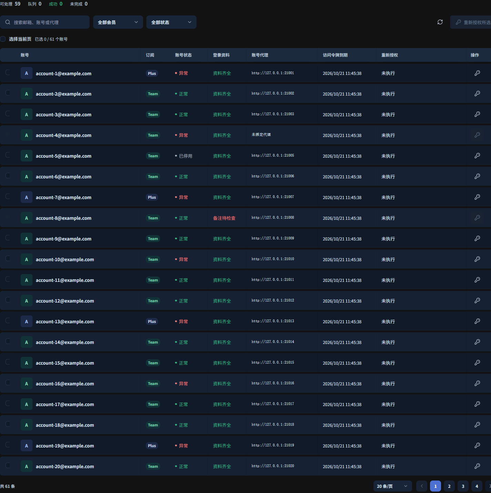

# 账号重新授权

RS 网关独立插件，通过原账号备注中的 `邮箱----密码----2FA` 完成协议登录，沿用该账号绑定的代理，成功后将新授权写回原账号

**当前状态：实验性功能**，已在明确授权的指定账号验证 Free 恢复及 Free→Team 切换、写回与调度状态；具体版本和验证范围以 Releases 为准。其他账号仍可能遇到工作区歧义或人工验证要求，建议先单号核对结果



截图为模拟数据，不包含真实账号资料

登录协议与原版的逐项对照见 [协议对照](docs/PROTOCOL-PARITY.md)，RS 继续统一负责授权码交换及 RT 保存。

## 安装

在 [Releases](https://github.com/Lemon-57/rs-reauth-manager/releases) 下载对应版本的 `.tar.gz` 与 `.sha256`，核对摘要后，在 RS 的插件管理中上传安装

也可以使用 GitHub 来源安装，仓库填写 `Lemon-57/rs-reauth-manager`，标签留空查询最新已公开发行版，选择插件 `.tar.gz` 附件，不是 GitHub 自动生成的 Source code 归档

| 项目 | 范围 |
| --- | --- |
| 插件 ID | `personal.reauth-manager` |
| 当前源码版本 | `0.1.46`，公开版本以 Releases 为准 |
| 宿主兼容清单 | `>=3.29.7, <3.30.0` |
| 插件合同 | RPC v5、management v2、maintenance v1，manifestVersion 仍为 2 |
| 制品平台 | Linux x86_64，插件入口要求 glibc 2.28+ |
| 账号范围 | 全部套餐的 ChatGPT OAuth 账号，包含 Free |
| 功能入口 | 扩展页中的“账号重新授权” |

暂不提供 ARM64、Windows 或 macOS 宿主安装包，前端可由桌面和手机浏览器访问
当上游没有返回任何候选工作区时，点击“退回 Free”直接提交任务，不再弹出确认框。任务会重新获取同一用户的 Free 授权，通过身份、套餐、凭据版本和空闲状态校验后写回原账号并停止调度，不需要猜测或填写工作区 ID。

新增 Team/Business 账号完成身份、RT 保存、原生 RT 刷新核验后默认启用；核验不确定时保持暂停并提示核对。

Free 转 Team 按本次登录的唯一 Team 成员资格和新授权核验，旧令牌工作区与 RS 记录不一致不再单独阻止升级。

## 账号导入

账号表右上角“显示列”支持列显隐、顺序调整和恢复默认，账号与操作列保留。宿主沙箱禁止浏览器存储时，列设置在当前页面生效；列设置不会提交授权或修改账号配置。本插件始终复用账号固定代理，不提供自动换绑服务。

插件工具栏的“导入账号”支持 `邮箱----密码----2FA` 和 `邮箱----密码----2FA----RT`，每行一个账号，可混合格式一次提交，最多 100 行，后台串行处理并显示逐行结果。三字段走 RS 原生 OAuth；四字段由受保护管理入口验证提供的 RT，Team/Business 保存后启用，Free 保存后在原账号、原代理上进入手动原生 OAuth 队列。账号备注严格只保留前三字段。

导入需要管理员配置本机受保护管理入口 `protectedManagementUrl`，未配置时拒绝执行。完整说明见 [导入说明](docs/IMPORT.md)。

## 使用

1. 在 RS 原账号备注中填写 `邮箱----密码----2FA`，两处分隔符都是四个连字符，2FA 是 Base32 验证器密钥，不是当前六位动态码
2. 确认备注邮箱与原账号邮箱一致，并已绑定该账号自己的代理
3. 在插件中搜索或筛选账号，点击单号重新授权或勾选后点击批量重新授权，直接进入串行队列，不再弹出普通授权确认框；强制替换其他工作区仍须选择并确认
4. 查看处理进度及结果，失败、结果不确定或中断时先核对原账号，再手动决定是否重试

支持会员和状态筛选、10/20/50/100 条分页、选择当前页、停止队列及单号取消

热切换期间，新旧宿主可以同时保留已有连接，授权任务通过共享状态中的独占执行租约串行推进。待命宿主可读取任务和账号，但不能恢复、启动或写回授权。每次账号修改和队列保存前复核执行权，长操作期间续约；执行权丢失或状态保存冲突后停止当前处理，后续接管将未确认任务标记为中断，不自动重放登录、原生完成或 RT 刷新。

部署时先确认所有宿主没有实际授权子进程，再停用插件并等待所有副本退出，更新后将排空宿主置为待命，最后确认正式宿主持有唯一执行权。只在新宿主恢复数据库中的全局启用开关，不能阻止旧宿主再次启动插件。管理接口 `GET api/executor` 提供本进程执行权及待命状态，`POST api/standby` 仅在本进程没有授权工作时交接；待命不停止宿主或中断其已有业务连接。所有宿主须更新到支持租约的版本，不能将旧版无保护执行器与新版混用。

旧管理端口可能经 NAT 或入口转发至新宿主。交接前核对实际宿主的源码身份、监听进程和有效路由，不能仅凭连接端口判断已经访问旧实例；优先使用现有受保护的管理直达路径，不为交接插件执行权切换客户入口或停止网关。

状态读取独立于任务推进，推进超时或冲突仍会继续刷新；页面显示最近读取时间及读取失败提示。最近一批导入记录默认折叠为一行摘要，展开后保留完整历史。
账号后显示 RS 原生分组，多个分组全部列出，没有分组时显示“未分组”；搜索支持分组名称，展示不修改账号分组配置
顶部“可处理”按全部适用账号中 RS 状态为异常的账号数统计，包含备注或代理尚未齐全的账号；这类账号仍须补齐资料并空闲后才能提交
“成功”和“未完成”只统计本页最近一次提交的任务，单号和批量提交均会开始新的一次统计；重新进入插件或刷新整个页面时归零，不删除后台历史记录
重新进入页面时，历史成功结果在账号行显示“未执行”；最近一次历史失败、需核对或中断会保留其安全错误原因，当前页面新提交的结果优先显示
点击“成功”或“未完成”会列出本次对应账号并清除无关搜索、会员筛选和分页位置；普通读取最新账号不会清空本次结果
“队列”仍显示后台实际排队及运行中的任务数，重新进入页面不会取消已有任务或将其结果混入本次统计
Free、Plus、Pro、Team、Business 等全部套餐的 OAuth 账号均可列出、筛选和重新授权；API Key 或其他提供商账号不适用这个登录协议
缺少代理或登录资料时仍拒绝执行，不回退到直连或其他账号代理；本插件的账号范围与周限／重置卡插件独立，后者的 Free 排除规则不受影响
原 Team 工作区确认不可用，且只剩唯一明确的个人 Free 工作区时，自动获取同一用户的 Free 授权，暂停原账号后由 RS 原生 OAuth 完成接口交换并保存 RT，再核验并修正工作区元数据，不新建账号、不修改分组
完整读回验证通过后显示“登录成功：原工作区已失效，已切回 Free，已停止调度”，计入本次成功；无法确认身份或工作区时不降级，停用或写回结果不确定时显示需要核对且不自动重试
原记录为 Free 时，普通重新授权会优先检查是否加入唯一明确的 Team/Business 工作区；若有，自动获取目标工作区的独立授权，核验同一用户、邮箱、工作区、主体和实际团队套餐后写回，并开启调度，包括原本停用的 Free 账号。没有明确团队候选时仍保留个人 Free；多个团队候选时提示手动选择，不默认取首项。授权页以 `kind: organization` 返回的新组织工作区也纳入候选，最终必须由新 AT 和 ID Token 同时确认真实 Team/Business 套餐后才写回
自动切换过程中只在账号空闲且配置及凭据版本未变时暂停调度并写回，Team 凭据完整读回确认后才开启调度，再次检查配置及版本并回读最终状态；开启结果不确定时提示人工核对，不自动重放写回或开启请求

## Team 授权自动归组

最近一批导入记录会分别显示账号是否已入库、当前读回的套餐/启停/分组，以及可展开的原始导入和后续授权任务。只有账号 ID 与邮箱同时对应时才确认当前账号已入库；找不到原记录、邮箱不匹配或仅有同邮箱的新记录时保持待核对。正常启用不等于该次授权任务成功，不改写历史任务，不把历史结果计入本次成功/未完成，也不为修正展示重放导入或重新授权。

四字段导入的旧 RT 若仅包含邮箱、用户和主体而缺少 ChatGPT 工作区声明，先核对双令牌的用户绑定并保持暂停，再在同一账号和固定代理上复用原生 OAuth 登录。唯一 Team/Business 优先，只有唯一个人 Free 时保留 Free；多个 Team 不自动选择。新 AT 和 ID Token 必须同时证明本次选择的工作区、套餐及原用户和主体，原生 RT 保存、刷新及读回全部通过后才启用 Team 并归入 GPT Pro。已经创建但中断的账号可用普通重新授权继续，不重新导入旧 RT 或分配第二个代理。

手动、自动及批量重新授权，新令牌已由 RS 保存并通过双令牌身份和 Team/Business 套餐核验后，账号统一移动到唯一启用的 `GPT Pro` 分组，替换原分组成员关系。无需重新登录或再次刷新令牌来改组；Free 等其他套餐保留原分组。后续 RT 刷新检查失败仍保留暂停保护，归组不代表已启用。

分组目录完整分页读取，GPT Pro 缺失、重名或停用时停止并提示核对，不新建近似名称分组、不退回其他组。已在目标分组时不重复写入，写入后核对完整设置及凭据未变。

## 自动重新授权

手动、自动、批量及新增授权均不读取设备目录、不撤销其他设备，也不执行设备复核。原生 OAuth 保存并核验新授权后，由 RS 原生接口刷新 RT，核对轮换结果、双令牌身份与精确凭据版本，再按既有策略恢复调度。历史任务中的设备字段仅保留作审计，不再触发功能。详见 [授权完成核验说明](docs/SESSION-CLEANUP.md)。

开关状态与账号目录独立读取；目录超时不改变已保存的开关显示，开关状态未确认前禁用操作。页面“自动重新授权”开关控制后台巡检，关闭浏览器后仍由宿主维护回调执行；新安装默认关闭，更新保留已经保存的开关和尝试记录。支持状态通知的 RS 在账号持久凭据状态或错误原因提交变化后立即唤醒插件，插件完整分页检查目录并在同次通知内开始符合条件的任务；宿主每 30 秒补偿检查，旧宿主仅使用周期补偿。每次最多加入一个账号，手动队列优先，全部任务串行执行。

仅处理 RS 明确标为 `error` / `credential_expired`，或 `error` / `access_token_expired` 且公开 SDK 实时凭据状态为 `expired` 的已启用 OpenAI OAuth 账号，以及原生凭据状态确认为 `invalid` 且错误原因为 `credential_invalid` 的 OAuth 账号。RS 的 `access_token_expired` 也可能来自上游授权拒绝，不能仅看错误名称或令牌日期判断；缺少终态证据时不重新登录。单纯 AT 到期且凭据仍为 `ready` 时交给原生 RT 刷新，不将未知错误、封禁、限流、代理或额度问题推断为授权失效。账号必须具备匹配邮箱的三字段备注、原代理、用户/工作区/套餐身份和确定为空闲的并发状态；普通人工暂停账号跳过，只有当前原生凭据确认为 Invalid 的暂停账号允许自动重新授权，成功后仍保持暂停，后续能力测试确认后才能恢复调度。

自动与手动使用同一 RS 原生 OAuth 开始、协议登录和原生完成接口，沿用同一 state 与 PKCE。原生完成前暂停空闲账号调度，原生保存后核对新 AT、ID Token、原用户、邮箱、授权主体、工作区、套餐及精确版本，确认后继续验证原生 RT 刷新及保存。原生完成失败或结果不确定时保持暂停并人工核对，不改走插件交换 RT。自动与手动普通授权共用同一工作区选择、唯一 Team 升级及原团队失效后的唯一 Free 恢复；不按触发方式维护另一套协议分支。自动任务保留原代理及人工暂停，Team/Business 归组为 GPT Pro，其他套餐保留原分组，原暂停账号即使完成 Team 升级也不自动解除暂停；降级 Free 仍停止调度。需要管理员明确选择的强制工作区替换仍须人工确认。资料、凭据版本、在途状态变化或身份不确定时停止。

尝试意图在发送登录资料前持久化。同一异常只自动尝试一次，刷新页面、开关切换或插件重启都不会重放；失败需核对，写回不确定、中断或取消需要人工处理。观测到明确恢复后，新的独立异常也至少间隔六小时；人工成功处理可以解除需核对阻挡。密码错误、人工验证或登录限流直接结束；明确的登录挑战状态失效及动态码重试预算与手动登录共用同一有界实现。

开关独立持久化，不等待目录扫描、登录或队列锁；关闭后尚未开始的自动任务在下一次处理时取消，启动登录前再次读取开关。已在执行的任务完成当前有界流程；“停止队列”同时关闭自动功能并取消当前及待处理任务。自动结果单独保留在账号行，手动本次统计语义保持不变。队列与尝试记录不包含密码、2FA、令牌、回调或代理认证。

## 安全与边界

### 具体错误显示

新失败任务显示白名单内的失败阶段、原因和可用的最后 HTTP 状态，例如“密码验证：上游拒绝邮箱或密码”“创建 2FA 验证挑战”“提交 2FA 动态码”“邮箱验证码发送失败”“上游限制登录频率”“请求超时”“邮箱验证码待人工处理”“账号已被封禁或停用”“Payment Required，账号需要付款或订阅状态异常”。2FA 流程失败不再统一归因于备注密钥错误。
只有上游明确返回封禁、停用、暂停或终止访问等账号状态码时才显示封禁诊断；普通 HTTP 403 不推断为封禁，仍按实际阶段显示上游拒绝请求。
错误由协议层和 Rust 后端双重白名单投影，不透传上游正文、未知错误文本、URL、请求头、验证码或凭据。没有足够证据时明确显示未取得具体原因，不猜测代理或密码错误。
本地动态码生成与上游验证分开记录：等待新码超时会明确标为本轮未提交，保留此前验证失败的独立阶段及 HTTP 状态，不沿用此前响应来描述本地失败。上游明确返回无效码、过期码或挑战状态无效时显示对应原因和白名单机器码；只有 HTTP 409 时显示验证冲突，不推断为密钥错误。
步骤跟踪覆盖上游的 request、get、post 三种调用路径，包含打开登录页、获取安全校验令牌、密码验证、2FA、工作区、授权跳转及令牌交换。响应不是有效 JSON、响应结构异常与协议内部异常分别提示，不一律归为代理失败；已取得的步骤和对应 HTTP 状态不因未知错误码而丢失。
历史设备失败保留原记录，后续任务不再执行设备流程。账号行区分新增账号授权、手动重新授权和自动重新授权；新执行记录保存实现版本供审计，历史记录不补造未知原因。

旧通用错误仅在展示时标为“历史记录，未记录具体原因”，原任务历史保持不变，不能还原未保存的原因；只有以后手动发起的新任务才会记录新诊断，更新插件不会自动重登账号。

### 管理员强制写回其他工作区

当任务因“无法匹配原账号工作区，已停止写回”失败时，账号操作列提供“强制写回”入口。
新失败任务只保存从已登录会话提取的工作区 ID，不保存 RT、密码、2FA 或代理认证。
管理员必须选择一个明确工作区，并勾选“替换原授权并停止调度”后，才会创建逐号强制授权任务；默认不选工作区、不勾选确认，也不提供批量强制开关。
旧失败任务没有工作区列表时，先点击“重新检测工作区”走常规登录，取得列表后再打开强制写回确认。

强制任务重新登录并复用原代理及 RS 原生 state/PKCE，只返回所选工作区的授权码回调。RS 原生完成接口交换并保存 RT 后，插件核验同一邮箱、用户、主体、工作区及令牌有效期，核验失败保持暂停，绝不改走插件换取 RT 的分支。
新工作区可以是 Free、Plus、Team 等套餐，以实际验证的新授权为准。原生完成前检查账号空闲、配置及凭据版本未变并暂停调度，原生完成后核对精确版本与令牌身份，必要的工作区元数据修正逐字段保留原生令牌并读回验证；保留名称、备注、代理、权重、并发和模型权限，Team/Business 分组按上述归组规则处理。
停止调度或写回结果不确定时显示“需要核对”，不自动重复登录或写回，也不自动恢复调度。
此功能允许管理员明确替换工作区身份，强制写回仍需选择工作区并确认，不受“退回 Free”直接提交的交互调整影响。

- 安装使用 `trustedProcess`，意味着完整信任插件，不是操作系统沙箱，请审查源码和发行包来源
- 密码、2FA、完整代理地址和一次性回调只在内存与私有进程管道中传输，不写入任务状态、普通日志或页面
- 所有授权（手动、自动、Free 恢复、Team 切换及强制选择）均由 RS 原生 OAuth 完成接口交换并保存 RT；插件只向该接口交付授权码回调。工作区变更时仅通过公开 SDK 修正已核验的元数据，原生保存的三个令牌字段必须逐字段不变。最终刷新及保存也由 RS 原生账号刷新接口完成，不读取或撤销设备
- 为读取带认证代理，后台按精确单账号调用 RS 原生敏感导出接口，只取代理 URL，不持久化或向前端提供导出的凭据
- 保留原账号的名称、代理、权重、并发限制和模型权限，Team/Business 移入 GPT Pro，其他套餐保留原分组，不使用重置卡；原工作区常规授权保留启用状态，Free 恢复或管理员确认强制替换工作区时关闭调度；唯一 Team 自动切换是明确的启用例外，验证写回后开启调度，原本停用的 Free 账号也会开启
- 登录和写回前必须观测到账号在途请求为零，状态未知时停止，这不是跨系统流量锁，持续接收新请求的账号需要管理员选择空闲窗口
- 登录期间配置或凭据版本变化时停止写回，工作区无法确认时停止，不默认选择第一个工作区；管理员确认只放宽原工作区匹配要求，不放宽用户身份、并发与凭据版本检查
- 不绕过手机号、验证码或其他人工验证要求，遇到这些步骤时需要人工处理
- 取消可以终止尚未提交的协议进程和后续任务，不能撤销已经提交的授权，进程重启及不确定结果不会自动重放登录
- 手动每次最多排队 100 个账号，串行执行，单号超时 420 秒；自动任务规则见下文

请仅处理自己拥有或明确获授权的账号，并遵守服务条款

## 协议与上游

协议模块来自 [boji1334/reauth-web](https://github.com/boji1334/reauth-web)，固定提交 `db8251817fd1baefc83c14c851135fb6078bc001`
仅保留登录必需的五个 `vendor/lib` 模块与 RFC 6238 TOTP 实现，不依赖重登站，不包含兑换、支付、账号注册或其 Web 服务
`vendor/lib` 原模块保持不变，适配代码在 `protocol/runner.py`，本地 TOTP 生成与等待逻辑在 `protocol/totp.py`，原始 MIT 许可位于 `protocol/LICENSE.reauth-web`
会话读取失败时继续使用授权页的有界 JSON/hydration 工作区证据，相关解析位于 `protocol/workspace_pages.py`；不执行页面脚本，不按 ID 子串或默认首项匹配。令牌交换禁止自动跟随重定向。适配修复、保留差异及仍需处理的宿主身份校验边界见 [协议适配差异审查](docs/UPSTREAM-PARITY.md)
适配层接受 RS 返回的官方桌面授权外层链接，仅拆出并校验 `authorize_url` 后交给上游协议；常规路径不重新生成或替换 RS 的 state、PKCE、client_id 和回调地址，也支持直接 OAuth 链接
新登录会话的首个原生授权页 GET 遇到明确的 Cloudflare 403 挑战时，等待两秒后仅重取一次，沿用原代理、TLS 身份、会话、请求头及原生 OAuth 参数。上游要求等待更长、持续挑战或其他拒绝时停止并显示真实错误；不自动处理人工挑战，不重放密码、2FA、工作区选择或令牌交换。

同一挑战的 2FA 校验最多提交三次不同动态码，仅对明确的验证码无效或过期换码；重试等待预算为 TOTP 刷新周期加五秒余量。登录身份、密码或 MFA 步骤明确返回 HTTP 400/409 的 `invalid_state` 时，放弃旧挑战和 Cookie，使用原代理最多重建一次登录会话；所有授权均保留 RS 的 state、PKCE 和待完成流程。已提交的动态码在同一任务内不重复使用
429、封禁、付款、密码错误、人工验证、无具体错误码的 409、传输异常、授权回调校验失败和令牌交换失败均不自动重登或猜测换码。新会话仍失败时同时显示两次原因，不重放凭据写回，任务失败后不自动重新排队；单号 420 秒总时限不因恢复而延长
所有授权复用 RS 已生成的 state、PKCE、client_id 与回调地址，以及账号固定代理和现有登录协议。插件不得生成另一套 PKCE、调用上游 token 接口交换授权码，或用 SDK 写入自行换取的 RT。新增账号使用受保护的 `api/import` 入口，仍由 RS 原生 complete 保存 RT、备注和分组；以后新增账号也必须沿用这一原生链路，项目 AGENTS.md 已将其设为持久规则

后端使用 RS v3.29.7 的公开 SDK，固定提交 `78bc57c5cf24b01a38e985cdd739bb4ae89ce11f`，打包 CLI 使用同一合同源码构建
界面使用官方 `@codex-proxy/ui` v0.4.1 编译发行包，并参考 [插件工作台示例](https://github.com/zyycn/codex-proxy-plugins) 组织公开宿主桥、请求层、业务解码和 composable
不跨仓导入宿主内部源码，不读取管理 Cookie，也不直接访问宿主数据库

第三方来源与许可见 [NOTICE](legal/NOTICE.md) 和各协议、依赖的原始许可

## 本地开发

需要 Rust 1.97.0、Node.js 24+、pnpm 9.12.2 和 Python 3.11+
所有编译、依赖准备及打包均应在本机完成，不在生产应用服务器执行

```bash
pnpm --dir frontend install --frozen-lockfile
pnpm --dir frontend build
node verification/bridge-test.mjs
node verification/batch-test.mjs
node verification/conventions.mjs
cargo +1.97.0 fmt --manifest-path backend/Cargo.toml --check
cargo +1.97.0 clippy --manifest-path backend/Cargo.toml --all-targets --locked -- -D warnings
cargo +1.97.0 build --manifest-path backend/Cargo.toml --locked
node verification/protocol-test.mjs
python -B -m unittest discover -s verification -p 'test_*.py' -v
```

Windows 使用已配置到 PATH 的 `python`，Linux 使用 `python3`，也可以通过 `RS_REAUTH_TEST_PYTHON` 指定离线测试解释器
测试全部使用模拟宿主和虚构账号，不访问真实上游

`pnpm --dir frontend dev` 启动模拟数据预览，开发模式不代表已安装到 RS，也不会向真实账号发起授权

## 构建安装包

Linux 协议运行环境包含在发行包内，安装者无需在服务器装 Python 或依赖
运行包展开到宿主解出的插件目录中的随机私有子目录，权限为 0700，插件进程正常退出时清理；强制终止或宿主崩溃可能留下运行目录
该数据盘需可写、可执行并至少预留 256 MiB 空间，不依赖系统 `/tmp` 的容量或执行权限，不修改网关的只读根目录、挂载与 CPU/内存配置
登录前会先解包并检查 Python、TLS、协议依赖、TOTP 和离线桌面授权链接解析契约，失败时不会发起原生授权流程
管理员可通过已注册管理路由 `POST api/runtime-check`、正文 `{}` 单独执行自检，自检不读取登录资料、不访问上游、不创建账号任务

本地准备 Python 依赖及 [crane v0.20.6](https://github.com/google/go-containerregistry/releases/tag/v0.20.6)，然后执行

```bash
python -m pip install -r requirements-dev.txt
python scripts/prepare_runtime.py --crane /path/to/crane
python scripts/build_runtime.py
```

准备脚本按固定镜像摘要下载 Linux x86_64 Python 基础镜像，不需要 Docker daemon，不访问应用服务器
wheel 版本与 SHA-256 固定在 `protocol/requirements-linux.txt`，构建时校验镜像各层，并按 ELF 依赖闭包打包
缓存默认位于仓库内 `.cache/runtime`，不会提交到 Git
已有公开输入时可以用 `build_runtime.py --base-tar <file> --dependencies-dir <directory>` 指定其路径

Linux 原生构建示例

```bash
cargo +1.97.0 build --manifest-path backend/Cargo.toml --release --locked --target x86_64-unknown-linux-gnu
cpr-plugin package --manifest plugin.json --binary backend/target/x86_64-unknown-linux-gnu/release/reauth-manager --target x86_64-unknown-linux-gnu --resource-map web=frontend/dist --output-dir dist
python scripts/verify_artifact.py
```

Windows 交叉编译需先配置 Zig 与 cargo-zigbuild，将构建命令换成 `cargo +1.97.0 zigbuild --manifest-path backend/Cargo.toml --release --locked --target x86_64-unknown-linux-gnu.2.28`
`cpr-plugin` 使用与上文 SDK 相同的固定提交构建，生成的制品及校验文件位于 `dist/`

## 验证范围

测试入口覆盖真实 SDK 子进程的 RPC v4 管理与维护调用、账号范围、私有运行目录、错误阶段与原因、Free 恢复及强制写回的身份保护、未修改上游协议代码的离线传输、前端桥、本次任务统计及分页筛选
发行包校验核对 RPC v5、management v2、maintenance v1、目标平台、资源摘要及嵌入协议源码，拒绝源码与内嵌运行包不一致的制品
本地模拟与构建验证不等于真实账号完整链路或新版生产安装已验收，代理、账号状态、工作区和人工验证仍可能导致实际登录失败；新版本的实际验证范围以 Release 为准


## 授权后的套餐归组

RS 原生 OAuth 完成并核验身份、工作区、套餐与精确凭据版本后，Team/Business 沿用 GPT Pro 归组规则。
账号当前属于 GPT Pro 且核验后的套餐为 Free 时，自动移除 GPT Pro 并加入唯一启用的 Free Wait；保留其他已有分组，不重复添加 Free Wait。
本规则由重新授权插件的共用授权完成流程执行，手动、自动、批量授权一致，不依赖模型能力巡检开关；其他分组中的 Free 账号保持原分组。
归组只更新 groupIds；原生授权原有的暂停、RT 刷新及读回保护继续执行，备注、代理、并发、权重和模型政策不变。
Free Wait 缺失、重名、停用、凭据版本变化、存在在途请求或写入结果未确认时，任务停止并提示人工核对，不重放登录或分组写入。


## Team 工作区一致性修复（0.1.54）

RS 原生 OAuth 保存后，宿主可能先投影新套餐或工作区。插件仅接受双令牌已经验证的同一用户、目标工作区与套餐变化，其他账号设置及精确凭据版本仍必须一致，不能将正常 Free → Team 投影误判为外部配置变化。

此前中断可能留下 Team Token 与旧工作区元数据不一致。管理员对已停用账号提交新的手动授权时，插件先核验当前保存的双令牌、邮箱、用户主体、套餐与工作区，只修正元数据并逐字段读回；令牌保持原样。随后继续同一 RS 原生 OAuth 与刷新核验流程，保留暂停、并发、代理及模型政策。自动任务不自动修复历史半完成状态。身份或版本不一致时保持停止，不回滚旧 RT、不重放已提交回调。
